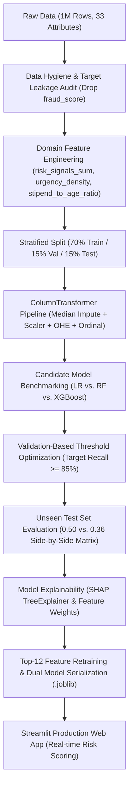
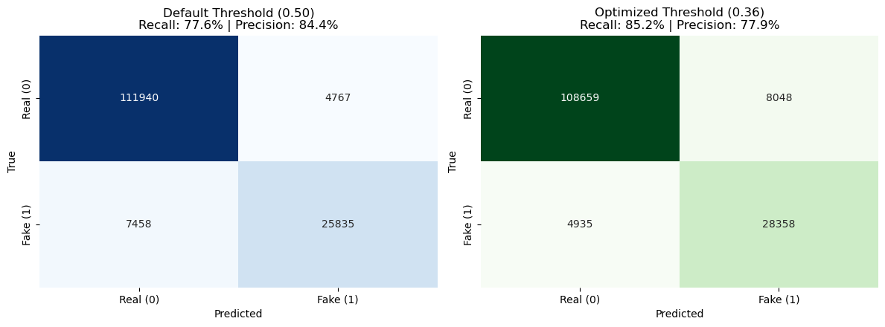
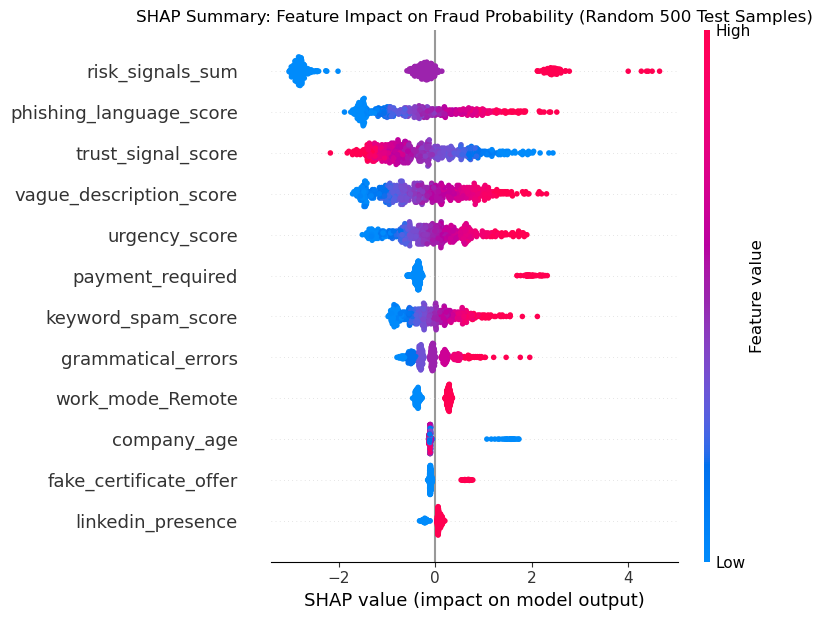
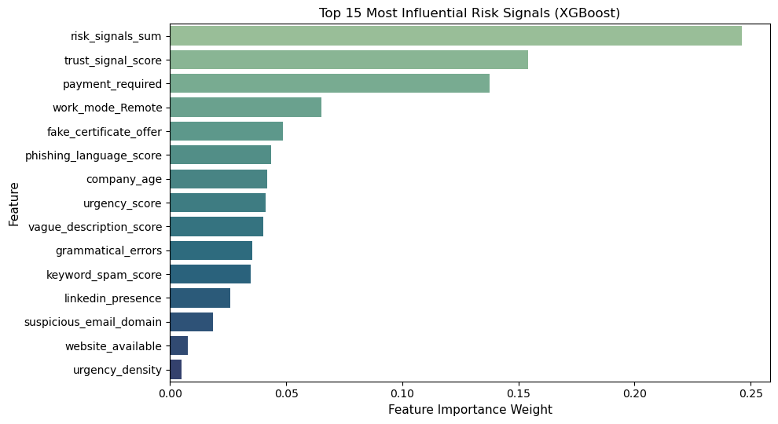

# 🛡️ SafeIntern: Job Fraud & Risk Detection Platform
> **End-to-End Decision Intelligence & Risk Scoring Engine for Scam Mitigation**

[](https://www.python.org/)
[](https://xgboost.readthedocs.io/)
[](https://scikit-learn.org/)
[](https://internship-fraud-detection-bomtodvbtrx7um4zydimwm.streamlit.app)
[](https://shap.readthedocs.io/)

> 🌐 **Live Web Application:** [SafeIntern Live Demo App (Streamlit Cloud)](https://internship-fraud-detection-bomtodvbtrx7um4zydimwm.streamlit.app)  
> 📊 **Benchmark Dataset:** [Dataset Specification](#-dataset--acquisition) | Included [`sample_data.csv`](sample_data.csv) (1,000 rows for instant replication)

---

## 📌 Executive Summary
Employment and internship scams have grown increasingly sophisticated, presenting severe financial, data security, and reputational risks for job seekers and recruitment platforms. 

**SafeIntern** is an end-to-end Machine Learning system engineered to detect fraudulent job and internship postings before publication. Trained on a 1,000,000-observation benchmark dataset, the system establishes a zero-leakage scikit-learn pipeline, benchmarks multiple models, and applies **risk-calibrated threshold tuning** on an independent validation set to optimize fraud recall.

### 🎯 Key Performance Highlights
* **Test ROC-AUC:** `0.9682` on 150,000 holdout test samples.
* **Fraud Recall:** Boosted from **`77.6%` $\rightarrow$ `85.2%`** via threshold optimization (`0.36`), intercepting **+2,523 additional fraudulent postings** on the holdout test set.
* **Overfitting Audit:** Minimal **Train vs. Test** divergence (`0.0027` ROC-AUC gap; Train: `0.9709`, Holdout Test: `0.9682`, verifying robust generalization with no overfitting).
* **Feature Efficiency:** Streamlined Top-12 feature model retains **`0.9682` Test ROC-AUC** with **no loss** in discriminative performance compared to the full 62-feature model.

---

## 🏛️ End-to-End System Architecture



---

## 🔬 Methodology & Prevention of Data Leakage

1. **Target Leakage Elimination:** `fraud_score` exhibited an extreme correlation of `+0.7614` with the target label and represents an upstream proxy of an external scoring engine not available at submission time. It was dropped early to guarantee zero leakage.
2. **Leak-Free Row-Level Feature Engineering:**
   * **`risk_signals_sum`:** A composite integer index summing concurrent red flags (`payment_required == 1`, `fake_certificate_offer == 1`, `suspicious_email_domain == 1`, `website_available == 0`, `linkedin_presence == 0`).
   * **`urgency_density`:** Urgency score divided by job description character length.
   * **`stipend_to_age_ratio`:** Ratio of offered stipend to company age (identifies suspicious compensation offered by infant entities).
3. **Strict Split Discipline:** Transformations (`preprocessor`) are fitted strictly on `X_train`. Validation and Test sets are transformed solely using parameters learned from training data.

---

## 📊 Candidate Model Benchmarking

Models were evaluated on the **Validation set (150,000 samples)** using threshold-independent ranking metrics:

| Model Architecture | Train ROC-AUC | Val ROC-AUC | ROC-AUC Diff | Val PR-AUC | Val Recall (0.50) | Val Precision (0.50) | Val F1 |
|:---|:---:|:---:|:---:|:---:|:---:|:---:|:---:|
| **Logistic Regression (Baseline)** | 0.9684 | 0.9682 | 0.0002 | **0.9077** | 0.9079 | 0.7071 | 0.7950 |
| **Random Forest** | 0.9638 | 0.9553 | 0.0085 | 0.8743 | 0.8999 | 0.6509 | 0.7554 |
| **XGBoost (Champion)** | 0.9709 | **0.9682** | 0.0027 | 0.9075 | 0.7733 | **0.8430** | **0.8066** |

### 💡 Why XGBoost was Selected over Logistic Regression:
While Logistic Regression achieved a virtually identical PR-AUC (`0.9077` vs `0.9075`), **XGBoost was chosen as the champion production model** for the following concrete technical reasons:
1. **Precision & Alert Fatigue:** At default threshold (0.50), XGBoost achieves **84.3% precision** vs Logistic Regression's **70.7% precision**. In bank and platform fraud operations, a 13.6-point drop in precision creates severe "alert fatigue", forcing compliance officers to review thousands of false positives.
2. **Overall Balance (F1-Score):** XGBoost yielded a superior default F1-score (`0.8066` vs `0.7950`).
3. **Non-linear Synergy:** Fraud behavior relies on complex interaction effects (e.g. upfront fee demands co-occurring with free recruiter emails and newly created entities). Gradient boosted trees capture these interactions natively without manual polynomial expansion.
4. **Regulatory Explainability:** XGBoost natively integrates with `shap.TreeExplainer` for exact, non-approximated Shapley feature attribution required by banking compliance standards.

---

## 🎯 Threshold Optimization (Business & Risk Trade-off)

In fraud prevention, **False Negatives (missing a scam)** carry far higher reputational and financial costs than reviewing a flagged legitimate post (False Positive).

To prevent test snooping, the decision threshold was tuned strictly on the **Validation set** to achieve `Recall >= 85%`, resulting in an optimal threshold of **`0.36`**.

### Holdout Test Set Evaluation (150,000 Unseen Samples):

| Decision Threshold | Holdout Recall | Holdout Precision | Test F1 | Scams Intercepted (TP) | Scams Missed (FN) | False Alarms (FP) |
|:---|:---:|:---:|:---:|:---:|:---:|:---:|
| **Default (0.50)** | 77.6% | 84.4% | 0.8087 | 25,835 | 7,458 | 4,767 |
| **Optimized (0.36)** | **85.2%** | **77.9%** | **0.8137** | **28,358** | **4,935** | 8,048 |

> **Business Impact:** Lowering the threshold to `0.36` catches **+2,523 additional fraudulent postings** on the holdout test set, slashing missed scams by **33.8%** with a controlled operational trade-off.

<p align="center">
  
</p>

---

## 🔍 Model Explainability & Key Drivers (SHAP)

<p align="center">
  
</p>

Feature importance and SHAP analysis reveal the primary drivers pushing predictions toward fraud:
1. **`risk_signals_sum` (24.6% weight):** The composite index summing concurrent red flags is the single most decisive fraud predictor.
2. **`trust_signal_score` (15.4% weight):** Absence of corporate credibility and verification signals.
3. **`payment_required == 1` (13.8% weight):** Demanding upfront application, registration, or equipment fees is almost universally indicative of advance-fee fraud.
4. **`work_mode_Remote` (6.5% weight):** Fully remote positions disproportionately attract scammers due to lack of geographic presence.
5. **`fake_certificate_offer == 1` (4.8% weight):** Scam schemes promising paid certificates.

<p align="center">
  
</p>

---

## 🚀 Streamlit Web Application

The project includes an interactive web dashboard for real-time compliance evaluation:
* **Interactive Scoring:** Allows compliance officers to input posting parameters and receive an instant probability score.
* **One-Click Scenarios:** Preloaded presets for *"Legitimate Tech Internship"* vs. *"High-Risk Remote Scam"*.
* **Explainability Breakdown:** Highlights triggered red flags and recommends actions (`Approved` vs. `Auto-Block / Escalated Audit`).

### Launching Locally:
```bash
# 1. Clone repository
git clone https://github.com/nazrinasgarova/internship-fraud-detection.git
cd internship-fraud-detection

# 2. Install dependencies
pip install -r requirements.txt

# 3. Launch the Streamlit dashboard
streamlit run app.py
```

### Public Cloud Deployment:
The dashboard is continuously deployed on **Streamlit Community Cloud**:
👉 **[Launch SafeIntern Dashboard](https://internship-fraud-detection-bomtodvbtrx7um4zydimwm.streamlit.app)** *(Hosted 24/7 on Streamlit Cloud)*

---

## 📂 Dataset & Acquisition

The system was evaluated on a comprehensive 1,000,000-observation benchmark dataset (`fake_internship_detection_dataset.csv`) detailing 33 job posting metadata attributes and scam behavioral indicators.
* **Format:** Tabular CSV (approx. 173.8 MB uncompressed).
* **Target:** `is_fake_posting` (Binary: `0` = Real, `1` = Fraudulent; ~22.2% positive rate).
* **Repository Sample:** A stratified 1,000-row sample ([`sample_data.csv`](sample_data.csv), ~175 KB) is bundled directly in this repository for zero-download pipeline testing and unit tests.
* **Full Dataset Access:** Due to GitHub's strict 100 MB file size limit, the full 173.8 MB dataset is hosted externally. If downloading from the course portal or Kaggle, place `fake_internship_detection_dataset.csv` into the project root directory.

---

## 📁 Repository Structure
```
├── assets/                                   # Extracted publication plots
│   ├── test_confusion_matrices.png           # Side-by-side test confusion matrices
│   ├── shap_summary_plot.png                 # SHAP TreeExplainer feature impact
│   └── feature_importance_top15.png          # Top 15 feature importances
├── Project_fake_internship_detection.ipynb   # Master research & experimentation notebook
├── app.py                                    # Streamlit web application
├── sample_data.csv                           # Lightweight 1,000-row test dataset (175 KB)
├── fraud_detection_xgb_full_pipeline.joblib  # Serialized production pipeline (62 features)
├── fraud_detection_xgb_top12_model.joblib    # Serialized lightweight model (Top 12 features)
├── requirements.txt                          # Python library dependencies
└── README.md                                 # Technical documentation
```

---

## 📜 Compliance & Transparency Note
*This study was validated on a large-scale benchmark dataset (1,000,000 observations). In production financial environments (e.g. Yelo Bank compliance operations), periodic model retraining and probability calibration against live incoming distribution drift are strongly recommended.*
