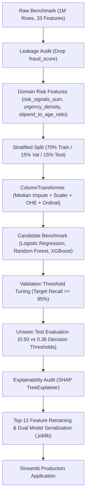

# SafeIntern: Job Fraud & Risk Scoring Platform
> **Decision Intelligence & Risk Scoring Engine for Scam Mitigation**

[](https://www.python.org/)
[](https://xgboost.readthedocs.io/)
[](https://scikit-learn.org/)
[](https://internship-fraud-detection-bomtodvbtrx7um4zydimwm.streamlit.app)
[](https://shap.readthedocs.io/)

* **Live Web Application:** [SafeIntern Risk Scoring Dashboard (Streamlit Cloud)](https://internship-fraud-detection-bomtodvbtrx7um4zydimwm.streamlit.app)
* **Sample Data:** Included [`sample_data.csv`](sample_data.csv) (1,000 rows for instant replication)

---

## Executive Summary
Employment and internship scams pose severe financial, data security, and reputational risks for job seekers, academic institutions, and financial organizations.

**SafeIntern** is an end-to-end Machine Learning risk platform engineered to intercept fraudulent listings prior to publication. Evaluated on a 1,000,000-record benchmark, the system establishes a zero-leakage Scikit-Learn pipeline, candidate model benchmarking, validation-calibrated decision threshold tuning, and SHAP-based regulatory explainability.

### Performance Highlights
* **Holdout Discrimination:** `0.9682` Test ROC-AUC on 150,000 unseen observations.
* **Recall Optimization:** Fraud recall increased from `77.6%` to `85.2%` at optimal risk threshold (`0.36`), intercepting **+2,523 additional fraudulent postings** on the holdout test set.
* **Overfitting Audit:** Minimal Train vs. Test ROC-AUC gap (`0.0027`; Train: `0.9709`, Test: `0.9682`).
* **Feature Efficiency:** Lightweight Top-12 feature model retains **`0.9682` Test ROC-AUC** with **no loss** in discriminative performance vs. the 62-feature pipeline.

---

## System Architecture



---

## Data Governance & Leakage Prevention

1. **Target Leakage Elimination:** The raw attribute `fraud_score` showed an extreme positive correlation (`+0.7614`) with the target label as an artifact of an upstream scoring engine. It was excluded from modeling to guarantee realistic evaluation.
2. **Leak-Free Row-Level Feature Engineering:**
   * `risk_signals_sum`: Composite integer index (0–5) aggregating concurrent red flags (upfront fee demand, fake certificate offer, suspicious email domain, missing website, missing LinkedIn).
   * `urgency_density`: Urgency score normalized by description character length.
   * `stipend_to_age_ratio`: Ratio of offered compensation to company tenure.
3. **Strict Partitioning Discipline:** All transformations are fitted strictly on `X_train`. Validation and holdout test sets are transformed purely through parameters learned during training.

---

## Model Benchmark & Selection

Candidate models were benchmarked on the 150,000-row Validation set:

| Model Architecture | Train ROC-AUC | Val ROC-AUC | ROC-AUC Diff | Val PR-AUC | Val Recall (0.50) | Val Precision (0.50) | Val F1 |
|:---|:---:|:---:|:---:|:---:|:---:|:---:|:---:|
| **Logistic Regression (Baseline)** | 0.9684 | 0.9682 | 0.0002 | **0.9077** | 0.9079 | 0.7071 | 0.7950 |
| **Random Forest** | 0.9638 | 0.9553 | 0.0085 | 0.8743 | 0.8999 | 0.6509 | 0.7554 |
| **XGBoost (Production Champion)** | 0.9709 | **0.9682** | 0.0027 | 0.9075 | 0.7733 | **0.8430** | **0.8066** |

### Selection Rationale:
While Logistic Regression achieved a comparable PR-AUC (`0.9077` vs `0.9075`), **XGBoost was chosen for production deployment** because:
* **Alert Fatigue Mitigation:** At default threshold, XGBoost delivers **84.3% precision** vs. Logistic Regression's **70.7%**. In bank compliance environments, a 13.6-point precision drop floods review queues with false positives.
* **Non-linear Risk Synergy:** Tree ensembles inherently capture multi-attribute fraud patterns (e.g. fees demanded alongside free domain emails and unverified infrastructure) without polynomial feature explosion.
* **Model Explainability:** Native compatibility with `shap.TreeExplainer` satisfies banking compliance standards for transparent decision auditability.

---

## Decision Threshold Optimization

In fraud classification, False Negatives (unintercepted scams) carry significantly higher operational and financial penalties than False Positives. Decision threshold was calibrated on the Validation set targeting $\ge 85\%$ recall, identifying **`0.36`** as the optimal operating point.

### Holdout Test Set Performance (150,000 Unseen Samples):

| Operating Threshold | Recall | Precision | F1 Score | Fraud Caught (TP) | Fraud Missed (FN) | False Alarms (FP) |
|:---|:---:|:---:|:---:|:---:|:---:|:---:|
| **Default (0.50)** | 77.6% | 84.4% | 0.8087 | 25,835 | 7,458 | 4,767 |
| **Calibrated (0.36)** | **85.2%** | **77.9%** | **0.8137** | **28,358** | **4,935** | 8,048 |

> **Operational Impact:** Operating at threshold `0.36` intercepts **+2,523 additional fraudulent listings**, reducing missed fraud by **33.8%** with a controlled operational trade-off.

<p align="center">
  
</p>

---

## Explainability & Risk Attribution (SHAP)

<p align="center">
  
</p>

Key drivers identified by TreeSHAP:
1. `risk_signals_sum` (24.6% importance): Co-occurrence of multiple indicators is the strongest fraud signal.
2. `trust_signal_score` (15.4% importance): Absence of verified institutional credibility.
3. `payment_required` (13.8% importance): Upfront monetary demands strongly correlate with advance-fee schemes.
4. `work_mode_Remote` (6.5% importance): Disproportionate prevalence among unauthorized remote listings.
5. `fake_certificate_offer` (4.8% importance): Predatory pay-for-certification traps.

<p align="center">
  
</p>

---

## Application & Deployment

### Public Web Application:
The production model is continuously deployed on Streamlit Community Cloud:  
👉 **[Launch SafeIntern Dashboard](https://internship-fraud-detection-bomtodvbtrx7um4zydimwm.streamlit.app)**

### Local Execution:
```bash
git clone https://github.com/nazrinasgarova/internship-fraud-detection.git
cd internship-fraud-detection
pip install -r requirements.txt
streamlit run app.py
```

---

## Repository Structure
```
├── assets/                                   # Evaluation plots (confusion matrices, SHAP summary)
├── Project_fake_internship_detection.ipynb   # Master research and pipeline notebook
├── app.py                                    # Streamlit web application
├── sample_data.csv                           # Lightweight 1,000-row sample for replication (175 KB)
├── fraud_detection_xgb_full_pipeline.joblib  # Serialized production pipeline (62 features)
├── fraud_detection_xgb_top12_model.joblib    # Serialized fast-inference model (Top 12 features)
├── requirements.txt                          # Pinned dependencies
└── README.md                                 # Technical documentation
```

---

## Governance & Compliance Notice
*Evaluated on a 1,000,000-observation benchmark. In financial production environments (e.g. Yelo Bank credit/risk monitoring pipelines), continuous performance monitoring, periodic retraining, and probability calibration against live demographic drift are required.*
