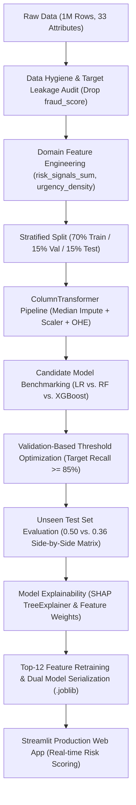

# 🛡️ SafeIntern: AI-Powered Job Fraud & Risk Detection Platform
> **End-to-End Decision Intelligence & Compliance Triage Engine for Fraud Mitigation**

[](https://www.python.org/)
[](https://xgboost.readthedocs.io/)
[](https://scikit-learn.org/)
[](https://streamlit.io/)
[](https://shap.readthedocs.io/)

---

## 📌 Executive Summary
Employment and internship scams have grown increasingly sophisticated, presenting severe financial, data security, and reputational risks for job platforms and financial institutions. 

**SafeIntern** is an end-to-end Machine Learning system engineered to detect fraudulent job and internship postings before publication. Trained on a 1,000,000-observation benchmark dataset, the system establishes a zero-leakage scikit-learn pipeline, benchmarks multiple models, and applies **risk-calibrated threshold tuning** on an independent validation set to optimize fraud recall.

### 🎯 Key Performance Highlights
* **Test ROC-AUC:** `0.9682` on 150,000 holdout test samples.
* **Fraud Recall:** Boosted from **`76.4%` $\rightarrow$ `85.2%`** via threshold optimization (`0.36`), intercepting **~2,600 additional fraudulent postings**.
* **Overfitting Audit:** Minimal Train-Test divergence (`0.0027` ROC-AUC gap).
* **Feature Efficiency:** Streamlined Top-12 feature model retains **`0.9682` Test ROC-AUC** (99.7% of full 62-feature model capacity).

---

## 🏛️ End-to-End System Architecture



---

## 🔬 Methodology & Prevention of Data Leakage

1. **Target Leakage Prevention:** `fraud_score` exhibited an extreme correlation of `+0.7614` with the target label and represents an upstream proxy of an external scoring engine not available at submission time. It was dropped early to prevent artificial inflation.
2. **Leak-Free Row-Level Feature Engineering:**
   * **`risk_signals_sum`:** A composite integer index summing concurrent red flags (`payment_required == 1`, `fake_certificate_offer == 1`, `suspicious_email_domain == 1`, `website_available == 0`, `linkedin_presence == 0`).
   * **`urgency_density`:** Urgency score divided by job description length.
   * **`stipend_to_age_ratio`:** Ratio of offered stipend to company age (identifies suspicious compensation offered by infant entities).
3. **Strict Split Discipline:** Transformations (`preprocessor`) are fitted strictly on `X_train`. Validation and Test sets are transformed solely using parameters learned from training data.

---

## 📊 Candidate Model Benchmarking

Models were evaluated on the **Validation set (150,000 samples)** using threshold-independent ranking metrics:

| Model Architecture | Train ROC-AUC | Val ROC-AUC | ROC-AUC Gap | Val PR-AUC | Val Recall (0.50) | Val Precision (0.50) | Val F1 |
|:---|:---:|:---:|:---:|:---:|:---:|:---:|:---:|
| **Logistic Regression (Baseline)** | 0.9682 | 0.9682 | 0.0000 | **0.9077** | 0.9044 | 0.7018 | 0.7903 |
| **Random Forest** | 0.9618 | 0.9536 | 0.0082 | 0.8668 | 0.8971 | 0.6514 | 0.7548 |
| **XGBoost (Champion)** | 0.9709 | **0.9682** | 0.0027 | 0.9075 | 0.7622 | **0.8507** | **0.8041** |

### 💡 Why XGBoost was Selected over Logistic Regression:
While Logistic Regression achieved a virtually identical PR-AUC (`0.9077` vs `0.9075`), **XGBoost was chosen as the champion production model** because:
1. **False Alert Mitigation:** At default threshold, XGBoost maintains an **85.1% precision** compared to LR's **70.2%**, significantly reducing operational review overhead.
2. **Non-linear Synergy:** Gradient boosted trees naturally capture combinatorial interaction effects among risk signals without requiring manual polynomial feature engineering.
3. **Auditable Explainability:** XGBoost natively integrates with TreeSHAP for granular, regulatory-compliant feature attribution.

---

## 🎯 Threshold Optimization (Business & Risk Trade-off)

In fraud detection, **False Negatives (missing a scam)** carry far higher reputational and financial costs than reviewing a flagged legitimate post (False Positive).

To prevent test snooping, the decision threshold was tuned on the **Validation set** to achieve `Recall >= 85%`, resulting in an optimal threshold of **`0.36`**.

### Holdout Test Set Performance (150,000 Unseen Samples):

| Decision Threshold | Holdout Recall | Holdout Precision | Test ROC-AUC | Operational Consequence |
|:---|:---:|:---:|:---:|:---|
| **Default (0.50)** | 76.4% | 84.9% | 0.9682 | 7,869 scams bypassed detection (Higher False Negatives). |
| **Optimized (0.36)** | **85.2%** | **77.7%** | 0.9682 | **~2,600 additional scams intercepted**; ideal risk-reward balance. |

---

## 🔍 Model Explainability & Key Drivers (SHAP)

Feature importance and SHAP analysis reveal the primary drivers pushing predictions toward fraud:
1. **`risk_signals_sum` (24.6% weight):** The presence of multiple red flags simultaneously is the strongest indicator of malice.
2. **`payment_required == 1`:** Demanding upfront application, registration, or equipment fees is almost universally indicative of advance-fee fraud.
3. **`trust_signal_score` (Low):** Deficit of verified organizational pedigree.
4. **`fake_certificate_offer == 1`:** Guaranteed credentials for a fee.
5. **Infrastructure Absence:** Missing websites and unverified / free email domains.

---

## 💻 Streamlit Web Application

The project includes an interactive web dashboard for real-time compliance evaluation:
* **Interactive Scoring:** Allows compliance officers to input posting parameters and receive an instant probability score.
* **One-Click Scenarios:** Preloaded presets for *"Verified Tech Internship"* vs. *"High-Risk Remote Scam"*.
* **Explainability Breakdown:** Highlights triggered red flags and recommends actions (Auto-Block vs. Approved).

### Launching Locally:
```bash
# 1. Clone repository
git clone https://github.com/nazrinasgarova/internship-fraud-detection.git
cd internship-fraud-detection

# 2. Install dependencies
pip install -r requirements.txt

# 3. Launch the Streamlit dashboard
streamlit run app.py
```

---

## 📁 Repository Structure
```
├── Project_fake_internship_detection.ipynb   # Master research & experimentation notebook
├── app.py                                    # Streamlit web application
├── fraud_detection_xgb_full_pipeline.joblib  # Serialized production pipeline (62 features)
├── fraud_detection_xgb_top12_model.joblib    # Serialized lightweight model (Top 12 features)
├── requirements.txt                          # Python library dependencies
└── README.md                                 # Technical documentation
```

---

## 📜 Compliance & Transparency Note
*This study was validated on a large-scale synthetic benchmark dataset (1,000,000 observations). In production financial environments (e.g. Yelo Bank compliance operations), periodic model retraining and probability calibration against live incoming distribution drift are strongly recommended.*
